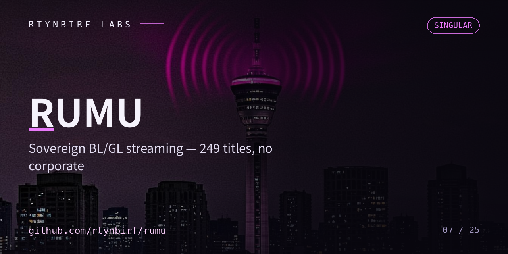

# СИНГУЛЯР РУМУ — честная заглушка

Код РУМУ (Sovereign BL/GL Streaming: P2P+autopilot, 249 тайтлов из bldub API)
живёт **веткой `rumu` в репозитории [singulyar](https://github.com/rtynbirf/singulyar/tree/rumu)**
(`cinema.html`, `catalog.js`, `cord.js`, `autopilot_client.js`).

Этот репозиторий — держатель имени. Контента здесь пока нет;
перенос кода ветки в самостоятельный репозиторий — отдельный такт.

- Ветка-источник: https://github.com/rtynbirf/singulyar/tree/rumu
- Владелец: rtynbirf
