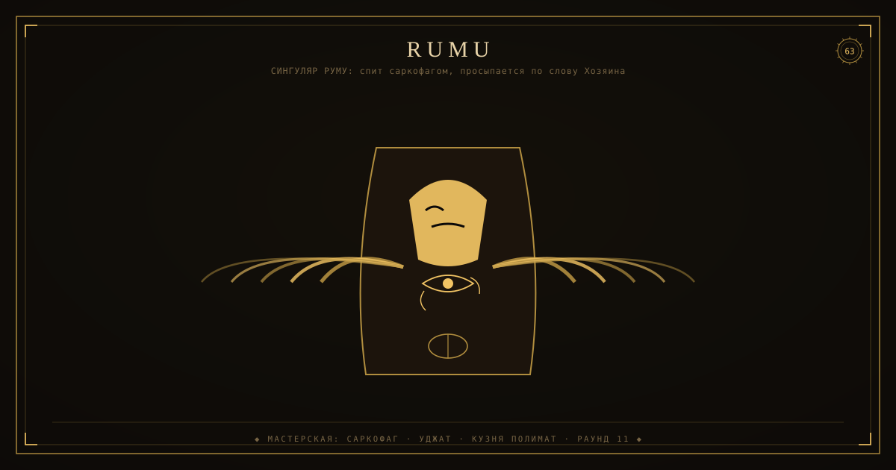

> ⚰️ **САРКОФАГ (2026-11-08).** Тело клетки перенесено: ветка [`rumu`](https://github.com/rtynbirf/singulyar/tree/rumu) репозитория `singulyar`. Пин тела: MANIFEST.json (`body.body_pin`) — сверяется оракулом singulyar. Этот репо — носитель пина, спит и не принимает пушей. Просыпается по слову Хозяина.

# СИНГУЛЯР РУМУ — честная заглушка

<!--ФОРЖ:МУЗА:НАЧАЛО-->

  
   
  

<!--ФОРЖ:МУЗА:КОНЕЦ-->

Код РУМУ (Sovereign BL/GL Streaming: P2P+autopilot, 249 тайтлов из bldub API)
живёт **веткой `rumu` в репозитории [singulyar](https://github.com/rtynbirf/singulyar/tree/rumu)**
(`cinema.html`, `catalog.js`, `cord.js`, `autopilot_client.js`).

Этот репозиторий — держатель имени. Контента здесь пока нет;
перенос кода ветки в самостоятельный репозиторий — отдельный такт.

- Ветка-источник: https://github.com/rtynbirf/singulyar/tree/rumu
- Владелец: rtynbirf

<!--ФОРЖ:ПОДВАЛ-->
---

  ◆ картина и штандарт — ручная ковка <a href="https://github.com/rtynbirf">КУЗНИ ПОЛИМАТ</a> · ЧЕЛОВЕК=АККАУНТ=PID1 ◆

